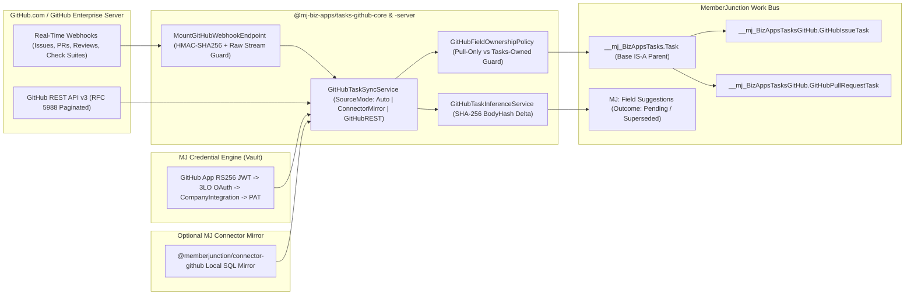
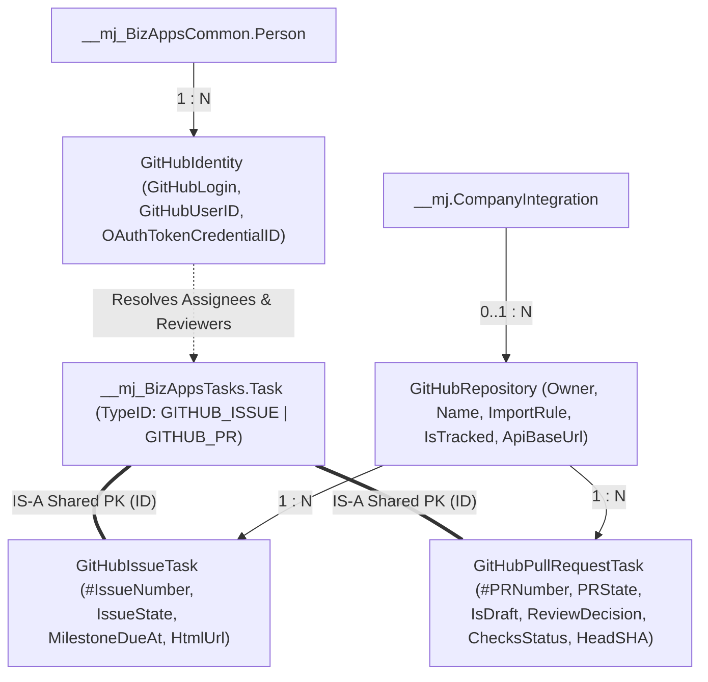

<p align="center">
  <picture>
    <source media="(prefers-color-scheme: dark)" srcset="https://github.com/MemberJunction/MJ/raw/main/MJ_logo_dark.png">
    <source media="(prefers-color-scheme: light)" srcset="https://github.com/MemberJunction/MJ/raw/main/MJ_logo.webp">
    
  </picture>
</p>

<h1 align="center">BizApps Tasks &mdash; GitHub Extension</h1>

<p align="center">
  <strong>Strongly-typed GitHub Issues &amp; Pull Requests as first-class IS-A tasks on the <a href="https://github.com/MemberJunction/MJ">MemberJunction</a> Work Bus</strong>
</p>

<p align="center">
  <a href="#installation">Install</a> &middot;
  <a href="#architecture--data-flow">Architecture</a> &middot;
  <a href="#strict-field-ownership-model">Field Ownership</a> &middot;
  <a href="#angular-ui--components">Angular UI</a> &middot;
  <a href="#pilot-webhook-bootstrap">Webhooks</a> &middot;
  <a href="#developer-setup--ci-guards">Development</a>
</p>

<p align="center">
  
  
  
  
  <a href="./LICENSE"></a>
</p>

---

Engineering work lives in GitHub Issues and Pull Requests, while cross-functional planning, OKRs, effort estimates, due dates, 15Five status reporting, and autonomous agent orchestration live in [**BizApps Tasks**](https://github.com/MemberJunction/bizapps-tasks). Traditional two-way sync bridges fail because GitHub webhooks overwrite human planning fields or stale database edits clobber live PR titles and labels.

**BizApps Tasks — GitHub Extension (`mj-bizapps-tasks-github`)** solves this cleanly as a **MemberJunction Open App**:

1. **True IS-A `Task` Subtypes (`AutoEnsureOnSave`)** — `GitHubIssueTask` and `GitHubPullRequestTask` extend `__mj_BizAppsTasks.Task` directly via MemberJunction's declarative `SubtypeSelector`, sharing primary keys and participating natively in every Tasks dashboard, Kanban board, Gantt chart, dependency graph, and 15Five `WorkReport`.
2. **Conflict-Free Field Ownership** — GitHub owns code/review state (pull-only); BizApps Tasks owns human planning state (`DueAt`, `HoursEstimated`, `ParentID`, `Priority`, `CategoryID`, `READY_FOR_FACTORY`) and never loses data on re-sync.
3. **Human-Verified Ambient Planning Inference** — When an issue or PR body changes, candidate planning values are proposed as `MJ: Field Suggestions` chips rather than silently mutating human schedules.
4. **Zero-Rate-Limit Local Mirror + Live Webhooks** — Seamlessly reads from `@memberjunction/connector-github` local database mirrors (`ConnectorMirror`) when configured, falls back to authenticated GitHub REST (`GitHubREST` — GitHub.com and GitHub Enterprise Server), and processes real-time HMAC-SHA256 webhooks via a 1-line Express bootstrap.

---

## Installation

Install into any MemberJunction environment using the [MJ CLI](https://github.com/MemberJunction/MJ/tree/main/packages/MJCLI):

```bash
mj app install https://github.com/MemberJunction/bizapps-tasks-github
```

This single command:

1. Reads [`mj-app.json`](./mj-app.json) and verifies platform compatibility
2. Ensures upstream Open App dependencies ([`mj-bizapps-common`](https://github.com/MemberJunction/bizapps-common) and [`mj-bizapps-tasks`](https://github.com/MemberJunction/bizapps-tasks)) are installed
3. Creates the `__mj_BizAppsTasksGitHub` schema (SQL Server or PostgreSQL) and runs Skyway migrations
4. Syncs `GITHUB_ISSUE` / `GITHUB_PR` `TaskType` definitions, lifecycle statuses, actions, Chief of Staff skills, and the **GitHub Sync** navigation item
5. Registers `@mj-biz-apps/tasks-github-server` (`LoadBizAppsTasksGitHubServer`) in MJAPI and `@mj-biz-apps/tasks-github-ng` (`LoadBizAppsTasksGitHubClient`) in MJExplorer

### App Lifecycle Commands

```bash
mj app list                              # List installed Open Apps
mj app info mj-bizapps-tasks-github      # Inspect version, schema, and packages
mj app upgrade mj-bizapps-tasks-github   # Upgrade to the latest release
mj app disable mj-bizapps-tasks-github   # Temporarily disable server & UI hooks
mj app enable mj-bizapps-tasks-github    # Re-enable
mj app remove mj-bizapps-tasks-github    # Uninstall cleanly via teardown scripts
```

---

## Architecture & Data Flow

### End-to-End Ingestion, Vault Auth & Field Suggestion Pipeline



### IS-A Entity & Identity Model (`__mj_BizAppsTasksGitHub`)



---

## Strict Field Ownership Model

Instead of fragile bidirectional conflict resolution, every field has a single authoritative owner enforced by `GitHubFieldOwnershipPolicy`:

| Ownership Tier | Fields | Sync & Mutation Behavior |
| --- | --- | --- |
| **GitHub-Owned (Pull-Only)** | `Task.Name` (title), `Task.Description` (body), GitHub lifecycle status (`OPEN`, `IN_PROGRESS`, `COMPLETED`, `NOT_PLANNED`, `DRAFT`, `REVIEW_REQUIRED`, `CHANGES_REQUESTED`, `APPROVED`, `MERGED`, `CLOSED`), labels, branches, `HeadSHA`, `Additions` / `Deletions`, and `TaskAssignment` (`Primary` / `Reviewer` mapped via `GitHubIdentity`) | Updated deterministically from GitHub webhooks and repository sync runs. Locked against silent local drift. |
| **Advisory UI Projections** | `GitHubPullRequestTask.ChecksStatus`, `GitHubPullRequestTask.ReviewDecision` | Refreshed on `check_suite`, `check_run`, and `pull_request_review` events via GitHub REST (with a bounded 5,000-entry offline LRU fallback). Designed for fast dashboard filtering — downstream merge gates (`bizapps-software-factory`) always re-verify live GitHub check runs and reviews at merge time. |
| **Tasks-Owned (Human & Factory Planning)** | `DueAt`, `HoursEstimated`, `HoursActual`, `ParentID` (OKR / parent initiative), `Priority`, `CategoryID`, `PercentComplete`, and `READY_FOR_FACTORY` | **Never overwritten** when GitHub re-syncs an Issue or PR. |
| **Ambient `MJ: Field Suggestions`** | Candidate `DueAt`, `HoursEstimated`, `ParentID`, `Priority`, `CategoryID` parsed from Issue/PR markdown | Emitted only when `BodyHash` (SHA-256) changes. Humans accept or dismiss suggestions in one click inside Tasks. Authoritative GitHub `MilestoneDueAt` automatically marks pending `DueAt` suggestions as `Outcome = 'Superseded'`. |

---

## Dual-Mode Sync & MJ Vault Authentication

### `ConnectorMirror` + `GitHubREST` Auto-Selection

`GitHubTaskSyncService` supports three `SourceMode` strategies:

- **`Auto` (Default)** — Inspects `GitHubRepository.CompanyIntegrationID` for active `@memberjunction/connector-github` `MJ: Company Integration Entity Maps`. When present, issues/PRs are reconciled directly from the local SQL mirror with **zero GitHub API rate-limit consumption**; otherwise, seamlessly falls back to `GitHubREST`.
- **`ConnectorMirror`** — Forces local database mirror reads via `ConnectorGitHubMirrorRepositoryFetcher`.
- **`GitHubREST`** — Queries GitHub.com or GitHub Enterprise Server (`ApiBaseUrl`) directly with RFC 5988 `Link` header pagination and transient `429`/`5xx` retry backoff.

### MJ Vault Credential Resolution Chain

`GitHubVaultAuthResolver` resolves tokens securely through `@memberjunction/credentials` (`CredentialEngine`) without hardcoding environment secrets:

1. **Explicit Repository / Identity Credential** (`OAuthTokenCredentialID` 3LO token or repository-scoped Vault credential)
2. **GitHub App Installation Token** (RS256 JWT signing + in-memory installation token cache with automatic pre-expiry refresh)
3. **`MJ: Company Integrations` Linked Credential**
4. **Environment Fallback** (`GITHUB_TOKEN` / `GH_TOKEN`) for local development and CI

---

## Package Topology

| Package | NPM Name | Role & Key Exports |
| --- | --- | --- |
| **Entities** | `@mj-biz-apps/tasks-github-entities` | CodeGen-generated entity subclasses & Zod schemas for `GitHubRepository`, `GitHubIdentity`, `GitHubIssueTask`, and `GitHubPullRequestTask` |
| **Core** | `@mj-biz-apps/tasks-github-core` | `GitHubFieldOwnershipPolicy`, `GitHubTaskSyncService`, `ConnectorGitHubMirrorRepositoryFetcher`, `GitHubVaultAuthResolver`, `GitHubTaskInferenceService`, `GitHubWebhookService` |
| **Actions** | `@mj-biz-apps/tasks-github-actions` | `TasksGitHub.SyncRepositoryTasks`, `TasksGitHub.HandleWebhook`, `TasksGitHub.InferTaskFields` |
| **Server** | `@mj-biz-apps/tasks-github-server` | TypeGraphQL resolvers, `LoadBizAppsTasksGitHubServer()`, `createGitHubTasksWebhookHandler()`, and 1-line `MountGitHubWebhookEndpoint()` |
| **Angular** | `@mj-biz-apps/tasks-github-ng` | `LoadBizAppsTasksGitHubClient()`, `TasksGitHubAngularModule`, `GitHubTasksAdminResource`, `GitHubTaskDetailBadgeComponent`, and strongly-typed view-model builders |
| **Integration Tests** | `@mj-biz-apps/tasks-github-integration-tests` | Live-DB verification suite (`github-tasks-extension`: `GH1`–`GH3`) |

---

## Actions & Agent Skills

### Registered MemberJunction Actions

| Action Driver Class | Purpose |
| --- | --- |
| `TasksGitHub.SyncRepositoryTasks` | Reconciles tracked `GitHubRepository` records (filtered by `ImportRule`: `All`, `AssignedOnly`, `LabeledOnly`) into IS-A `Task` rows using `Auto`, `ConnectorMirror`, or `GitHubREST` |
| `TasksGitHub.HandleWebhook` | Verifies constant-time HMAC-SHA256 signatures and processes `issues`, `pull_request`, `pull_request_review`, `check_suite`, and `check_run` webhook payloads |
| `TasksGitHub.InferTaskFields` | Evaluates Issue/PR markdown bodies on `BodyHash` delta and writes non-destructive `MJ: Field Suggestions` |

### Chief of Staff Skill

Ships the **`"GitHub Tasks & Pull Requests"`** skill in `metadata/skills`, equipping `Chief of Staff` and workspace co-agents to combine local Work Bus queries with MemberJunction's core `GitHub - *` actions (`GitHub - Get Pull Request Context`, `GitHub - Create Or Update Issue`, `GitHub - Submit Pull Request Review`, etc.).

---

## Angular UI & Components

`@mj-biz-apps/tasks-github-ng` registers a dedicated **GitHub Sync** navigation item inside the **Tasks** application and exports embeddable components built with Angular 21 block control flow (`@if` / `@for` / `@switch`) and MJ design tokens (`var(--mj-*)`).

| Component | Selector / Registration | Capabilities |
| --- | --- | --- |
| **`GitHubTasksAdminResource`** | `@RegisterClass(BaseResourceComponent, 'GitHubTasksAdminResource')` / `<mj-tasks-github-admin-resource>` | **Repositories Tab**: Toggle `IsTracked`, configure `ImportRule`, inspect `ConnectorMirror` vs `GitHubREST` source badges, and trigger on-demand `Sync GitHub Repository Tasks`.<br>**My GitHub Identity Tab**: Self-service linking between the signed-in user's `Person` record and `GitHubIdentity` (`GitHubLogin`) + MJ Vault / 3LO OAuth status.<br>**Webhook Activity Tab**: Live health & recent delivery telemetry, with tab state persisted via `UserInfoEngine` and co-agent context wired via `NavigationService`. |
| **`GitHubTaskDetailBadgeComponent`** | `<mj-tasks-github-detail-badge>` | Embeddable task header/detail widget accepting `[taskId]`. Renders Issue/PR `#Number`, state chip, `Draft` pill, `ReviewDecision`, `ChecksStatus`, `+Additions / -Deletions` diff stats, `HeadBranch -> BaseBranch`, external GitHub deep link, and pull-ownership lock indicator. |

### Embedding the Detail Badge in Any Angular View

```html
<mj-tasks-github-detail-badge
  [taskId]="selectedTaskId">
</mj-tasks-github-detail-badge>
```

---

## Pilot Webhook Bootstrap

Mount real-time GitHub webhook ingestion into any Express-compatible MJAPI host in a single line — no custom raw-body middleware required:

```typescript
import express from 'express';
import { MountGitHubWebhookEndpoint } from '@mj-biz-apps/tasks-github-server';

const app = express();

// Exposes:
//   POST /webhooks/github        (raw UTF-8 stream/buffer assembly + 10 MiB guard + HMAC-SHA256 verification)
//   GET  /webhooks/github/health (readiness probe: { status: 'ok', endpoint, secretConfigured })
MountGitHubWebhookEndpoint(app, {
    path: '/webhooks/github',
    autoProcessDelivery: true,
});
```

---

## Database Schema (`__mj_BizAppsTasksGitHub`)

Deployed with full parity across **SQL Server** (`migrations/` & `teardown/`) and **PostgreSQL** (`migrations-pg/` & `teardown-pg/`):

| Table | Entity Name | Description |
| --- | --- | --- |
| `GitHubRepository` | `MJ_BizApps_Tasks_GitHub: Git Hub Repositories` | Tracked repositories (`Owner`, `Name`, `FullName`, `IsTracked`, `ImportRule`, `DefaultProjectID`, `CompanyIntegrationID`, `DeliveryPolicyID`, `ApiBaseUrl`, `LastSyncedAt`) |
| `GitHubIdentity` | `MJ_BizApps_Tasks_GitHub: Git Hub Identities` | Maps `MJ_BizApps_Common: People` (`PersonID`) to `GitHubLogin` / `GitHubUserID` and optional Vault `OAuthTokenCredentialID` |
| `GitHubIssueTask` | `MJ_BizApps_Tasks_GitHub: Git Hub Issue Tasks` | Cross-schema IS-A child of `__mj_BizAppsTasks.Task` (`IssueNumber`, `GitHubIssueID`, `IssueState`, `StateReason`, `MilestoneTitle`, `MilestoneDueAt`, `BodyHash`, `HtmlUrl`) |
| `GitHubPullRequestTask` | `MJ_BizApps_Tasks_GitHub: Git Hub Pull Request Tasks` | Cross-schema IS-A child of `__mj_BizAppsTasks.Task` (`PRNumber`, `GitHubPRID`, `PRState`, `IsDraft`, `HeadBranch`, `BaseBranch`, `HeadSHA`, `MergeCommitSHA`, `ReviewDecision`, `ChecksStatus`, `Additions`, `Deletions`, `HtmlUrl`) |

---

## Developer Setup & CI Guards

```bash
# Install dependencies from lockfile
pnpm install --frozen-lockfile

# Build all 6 workspace packages in topological order (including Angular ngc)
pnpm run build:packages

# Run all Vitest unit test suites
pnpm run test

# Apply SQL Server migrations locally
pnpm run mj:migrate
```

### Repository Structure

```text
bizapps-tasks-github/
├── mj-app.json                        # MemberJunction Open App manifest
├── tsconfig.angular.json              # Strict Angular 21 ngc compiler config
├── packages/
│   ├── Entities/                      # @mj-biz-apps/tasks-github-entities
│   ├── Core/                          # @mj-biz-apps/tasks-github-core
│   ├── Actions/                       # @mj-biz-apps/tasks-github-actions
│   ├── Server/                        # @mj-biz-apps/tasks-github-server
│   ├── Angular/                       # @mj-biz-apps/tasks-github-ng
│   └── IntegrationTests/              # @mj-biz-apps/tasks-github-integration-tests
├── migrations/                        # Skyway T-SQL migrations
├── migrations-pg/                     # Skyway PostgreSQL migrations
├── teardown/                          # Clean uninstall T-SQL scripts
├── teardown-pg/                       # Clean uninstall PostgreSQL scripts
├── metadata/                          # TaskTypes, Actions, Skills, and Tasks nav item
└── guides/                            # Sync, Webhooks & Ownership documentation
```

### Further Documentation

- [**GitHub Tasks Sync, Webhooks & Field Ownership Guide**](./guides/GITHUB_TASKS_SYNC_AND_OWNERSHIP_GUIDE.md)

---

## License

Business Source License 1.1 — see [LICENSE](./LICENSE) for details.

---

<p align="center">
  Built on <a href="https://github.com/MemberJunction/MJ">MemberJunction</a> &mdash; the metadata-driven AI &amp; application platform.
</p>
